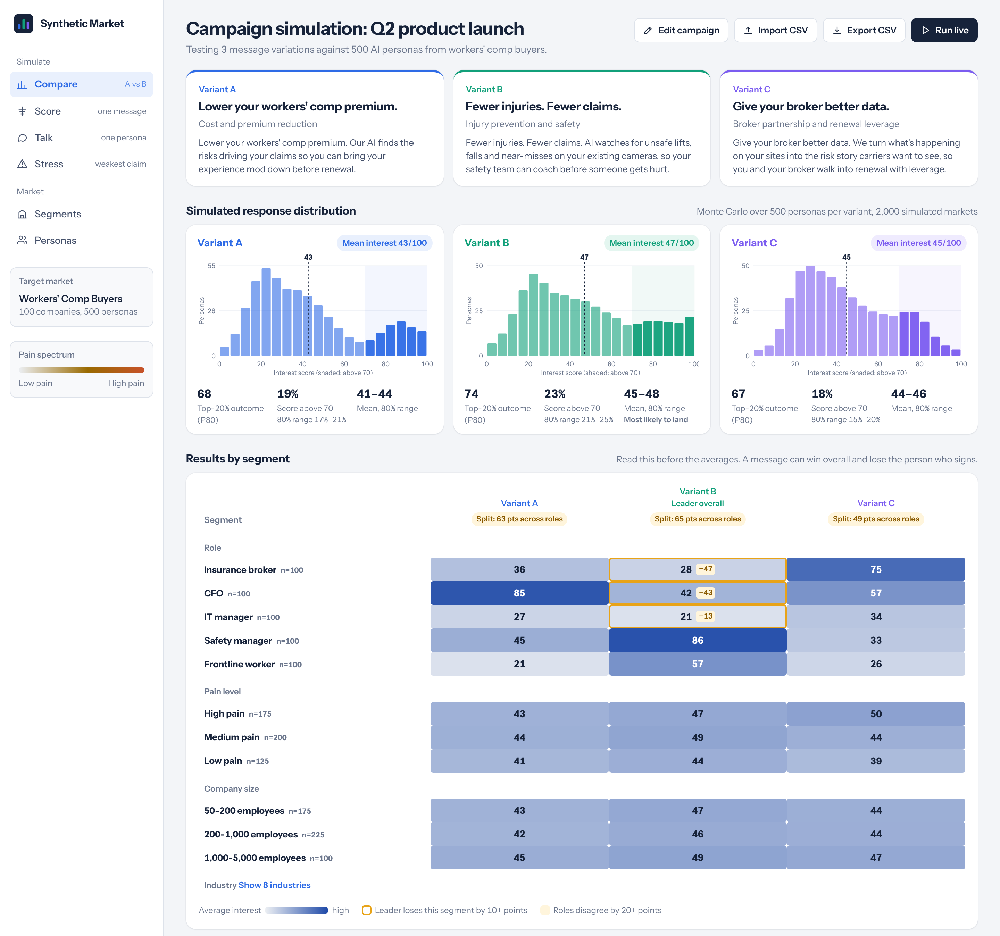

# Synthetic Market Simulator

Test positioning, messaging, pricing and features against a synthetic market of AI buyer personas
before anything ships. Read the results by segment, then take the right questions to real customers.

**[Open the live demo](https://jamesallgood.github.io/synthetic-market-simulator/)** · Built by
[James Allgood](https://www.linkedin.com/in/jamesallgood)



## Why this exists

After my [podcast conversation](https://lnkd.in/gpXy7J_G), I kept getting the same two questions:
how do you use the synthetic market simulator, and how did you build it? This repo is the answer
to both.

At CompScience, an AI-powered workers' comp platform, we tested pricing, messaging and features
against a simulated market before anything shipped. That cut out the launch-and-relaunch cycle most
teams accept as normal, and we launched 50% more features and products per year. When engineering
ships faster than marketing can fit releases into the schedule, there's no room for a relaunch. And
when product cycles get shorter, there are more blind spots and more market-fit misses. The
simulator was one piece of an AI-native marketing stack built to keep up.

The sample market here is fictional. No CompScience data is in this repo.

## What it is

A synthetic market of **100 companies** whose industry mix mirrors your customer distribution. Each
company has **five personas**, and each persona carries **3–5 pain points** specific to their role
and industry.

The sample is a workers' comp market, because that's where the method was built. The same product
means very different things to each of the five people involved:

| Role | Buying role | Core pain points (always present) | Plus |
|---|---|---|---|
| Insurance broker | Trusted advisor / gatekeeper | Improve client relationships, stand out in a commodity market, make more commission | Keeping clients at renewal, carrier leverage, servicing small accounts |
| CFO | Economic buyer | Rising premium, unpredictable total cost of risk | ROI proof, claim costs, lost productivity, audit surprises |
| IT manager | Technical veto | Securing video and employee data, small team with too many systems | Integrations, vendor reviews, site infrastructure |
| Safety manager | Champion | Preventing injuries, can't be on every site | OSHA, investigations, proving value, training |
| Frontline worker | Adoption risk | Getting hurt, being watched and blamed | Pace pressure, fear of reporting, safety theater |

Every persona also gets one pain that only exists for their role in their industry. A construction
CFO knows a high experience mod loses bids. A healthcare IT manager worries about HIPAA and cameras
near residents. A warehouse worker deals with pick-rate quotas and heavy lifting.

That structure lets you run Monte Carlo simulations on what resonates, where personas will balk,
and what they'll keep adopting. It doesn't replace a real Customer Advisory Board, but a CAB only
puts you in front of 6 to 20 real people. The simulator builds a response from hundreds of personas,
so you walk into the CAB already knowing which questions matter.

## How to use it

| Mode | What you do |
|---|---|
| **Score** | Run a positioning statement or pricing page past the full market and read the results by segment. |
| **Talk** | Interview one persona live and let them push back on your pitch. |
| **Stress** | Point your toughest critics at your weakest claim, and get back a version that survives them. |
| **Compare** | Run versions A, B and C side by side against the same personas. |

### The two rules

1. **Tell the model to be honest instead of flattering.** Every prompt in this repo tells personas to
   react like busy, skeptical buyers. A realistic panel centers in the 40s and 50s. If everyone
   loves your copy, something is wrong.
2. **Never average away segment splits.** A message that scores 7 overall can be a 9 with CFOs and a 3
   with brokers, and that split is the finding. The dashboard flags any variant whose roles disagree
   by 20+ points, and any segment the overall leader loses by 10+.

The demo shows rule 2 in action. Variant B ("Fewer injuries. Fewer claims.") is most likely to land
overall, but it trails A by 40+ points with CFOs and C by 40+ points with brokers. Both roles can
block a deal.

### What it's good at, and what it isn't

It's better at telling you something will land flat than at telling you exactly why. Use it to
narrow options and find the questions worth asking, then have the real conversations.

## Two ways to run it

### 1. The dashboard (this repo's web app)

```bash
cd app
npm install
npm run dev
```

It opens with demo data, so it works without an API key. The demo scores come from a simple,
transparent heuristic in `market/make_demo_results.py`, not from a model, and the app says so.

To run live, open **Settings** and paste a [Claude API key](https://console.anthropic.com). The key
stays in your browser and goes only to `api.anthropic.com`. A three-variant run at 100 personas is
15 API calls.

**Deploy your own copy:** fork the repo, then go to **Settings → Pages** and set the source to
**GitHub Actions**. The included workflow builds and publishes the dashboard on every push to `main`.

### 2. The Claude skill (no code)

`skill/synthetic-market/` is a reusable Claude skill with the same prompts and rules. Zip that folder
and add it as a skill in Claude, or copy it to `~/.claude/skills/` for Claude Code. Then give Claude
`market/output/market.json` (or `personas.csv`) and ask it to score, talk, stress or compare.

The skill can write results as CSV. **Import CSV** in the dashboard turns a chat run into charts.

## Build your own market

Everything about the market lives in one file: `market/config.example.json`.

```bash
cp market/config.example.json market/my-market.json
# edit industries, sizes, roles, pain points, triggers
python market/generate_market.py --config market/my-market.json
```

- **`industry_mix`**: weight it to match your real customer distribution.
- **`roles`**: the five people in your buying decision, with `core_pains` (always present) and
  `optional_pains` (sampled until each persona has 3–5).
- **`industry_pains`**: one extra pain per role per industry.
- **`themes`**: tags on each pain point (cost, safety, relationship…) used to compare across roles
  and to pick Stress critics.
- **`triggers`**: what's happening at each company right now. These matter more than titles.

The generator uses only the Python standard library. It writes `market.json`, `personas.csv` and
`companies.csv` to `market/output/`, and copies `market.json` into the dashboard.

I've since rebuilt the same structure as a 100-person panel of recruiters and hiring managers to
pressure-test my own job search materials. If you can name the roles and their pains, you can build
a market for it.

## How the numbers work

Each persona returns a 0–100 interest score with a confidence (low, medium or high). The dashboard
treats each score as a distribution (±5, 9 or 14 points), then runs 2,000 simulated markets by
resampling personas with replacement. It reports:

- **Mean interest**, with an 80% range
- **P80**, the top-20% outcome
- **Score above 70**, the share of personas likely to take a next step, with an 80% range

If two variants' ranges overlap, the run hasn't found a real difference, and the dashboard says so.

## Repo layout

```
market/
  config.example.json       the market definition: industries, roles, pain points
  generate_market.py        builds 100 companies × 5 personas
  make_demo_results.py      heuristic demo scores for the dashboard (not model output)
  output/                   market.json, personas.csv, companies.csv
skill/synthetic-market/     the Claude skill: SKILL.md plus prompts, rubric, report format
app/                        the React dashboard (Vite)
  src/lib/prompts.js        the prompts, mirrored in the skill
  src/lib/stats.js          Monte Carlo, stratified sampling, critic selection
  src/lib/analysis.js       segment splits and recommendation logic
```

## Let's talk

If releases are backing up because product is shipping faster than marketing can launch it, or if
your ICP seems off, I'd like to hear about it. I'm open to full-time marketing leadership roles and
advisory work, and I'm glad to start with a conversation about what your market is telling you.
Find me on [LinkedIn](https://www.linkedin.com/in/jamesallgood).

## License

MIT. Use it, fork it, build your own market.
